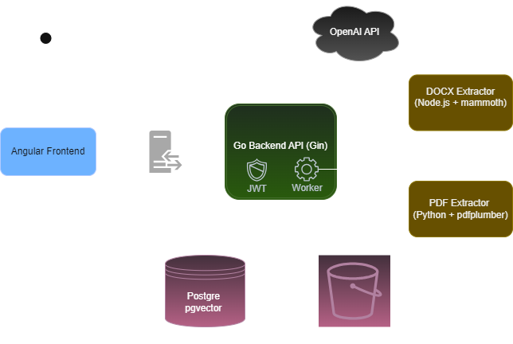

# Document Management System

A web application for storage, structuring and semantic analysis of text documents. Users can upload files, view metadata and ask natural language questions about document content using a Retrieval-Augmented Generation (RAG) pipeline.

---

## Features

- User registration and JWT-based authentication
- Document upload, management and download (PDF, DOCX, TXT)
- Automatic metadata extraction and background processing
- Vector embedding generation for uploaded content
- Natural language querying over document content via RAG
- Per-user data isolation

---

## Tech Stack

| Layer | Technology |
|---|---|
| Frontend | Angular |
| Backend | Go, Gin |
| Database | PostgreSQL 16 + pgvector |
| Object Storage | MinIO |
| AI / LLM | OpenAI API |
| PDF Extraction | Python microservice (pdfplumber) |
| DOCX Extraction | Node.js microservice (mammoth) |
| Reverse Proxy | Nginx |

---

## Architecture



The system is composed of the following layers:

- **Frontend** - Angular SPA served through Nginx, communicates with the backend over HTTPS/REST.
- **Backend** - Go/Gin REST API handling authentication, document management and orchestration of all other services.
- **PostgreSQL + pgvector** - relational data and vector embeddings share a single database instance. pgvector enables similarity search over chunk embeddings.
- **MinIO** - stores original document files as objects.
- **PDF / DOCX extractors** - isolated microservices called by the backend during background document processing.
- **OpenAI API** - used for embedding generation and answer completion in the RAG pipeline.

When a document is uploaded, the backend stores the file in MinIO, saves metadata to PostgreSQL and enqueues a background job. The worker extracts text via the appropriate microservice, splits it into chunks, generates embeddings and stores them in pgvector. When a user queries a document, the question is embedded, the most similar chunks are retrieved and the result is passed to the LLM to generate an answer.

---

## Running Locally

### Prerequisites

- Docker and Docker Compose
- An OpenAI API key

### 1. Configure environment variables

Copy the example file and fill in your values:

```bash
cp .env.example .env
```

The following variables must be set:

```env
OPENAI_API_KEY=sk-...
JWT_ACCESS_SECRET=your-access-secret
JWT_REFRESH_SECRET=your-refresh-secret
```

The remaining variables have working defaults for local development (see below).

### 2. Start all services

```bash
docker compose up -d --build
```

This starts:

| Service | Container | Exposed at |
|---|---|---|
| Frontend | dms_frontend | http://localhost |
| Backend API | dms_backend | http://localhost/api/v1 |
| PostgreSQL | dms_postgres | localhost:5433 |
| MinIO | dms_minio | http://localhost:9000 (API), http://localhost:9001 (Console) |
| PDF Extractor | dms_pdf_extractor | internal only |
| DOCX Extractor | dms_docx_extractor | internal only |
| Nginx | dms_nginx | http://localhost:80, https://localhost:443 |

### 3. Access the app

Open [http://localhost](http://localhost) in your browser.

The MinIO console is available at [http://localhost:9001](http://localhost:9001) - default credentials are `dms_admin` / `admin-sifra` unless overridden in `.env`.

---

## Environment Variables

| Variable | Default | Description |
|---|---|---|
| `DB_USER` | `admin` | PostgreSQL username |
| `DB_PASSWORD` | `admin-sifra` | PostgreSQL password |
| `DB_NAME` | `baza` | PostgreSQL database name |
| `JWT_ACCESS_SECRET` | `access_secret` | Secret for signing access tokens |
| `JWT_REFRESH_SECRET` | `refresh_secret` | Secret for signing refresh tokens |
| `MINIO_ACCESS_KEY` | `dms_admin` | MinIO root user |
| `MINIO_SECRET_KEY` | `admin-sifra` | MinIO root password |
| `OPENAI_API_KEY` | _(required)_ | OpenAI API key |
| `PDF_EXTRACTOR_URL` | `http://pdf_extractor:8000` | PDF extractor service URL |
| `DOCX_EXTRACTOR_URL` | `http://docx-extractor:3000` | DOCX extractor service URL |

> **Note:** The default secrets are suitable for local development only. Always use strong, randomly generated values in any other environment.

---

## API Documentation

Swagger UI is available in development mode at:

```
http://localhost:8080/swagger/index.html
```

It is disabled in production.

To regenerate the docs after changing annotations:

```bash
swag init -g cmd/server/main.go -o docs/ --parseDependency --parseInternal
```